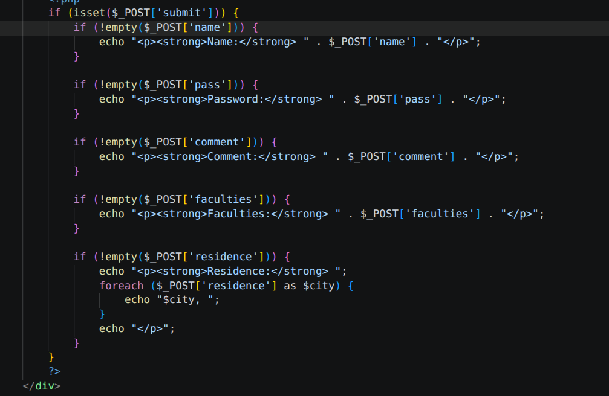

# Week 4

## Sharaxaadda Sawirka

Sawirka kore waxa uu muujinayaa koodhka PHP-ga ee maareynaya xogta laga soo diray form-ka, wuxuuna u kala baxaa qodobada soo socda:

1. **Hubinta Batoonka (`isset`):**
   Xariiqda ugu horreysa waxay hubinaysaa in qofku riixay batoonka `submit`. Koodhka inteeda kale ma shaqeynayo ilaa uu batoonkaas qofku riixo, si looga fogaado qaladaad marka bogga la furo.

2. **Qabashada Magaca (`name`):**
   Waxay hubinaysaa in sanduuqa magaca uusan maranayn (`!empty`), kadibna waxay shaashadda ku daabacaysaa magacii uu qofku soo qoray.

3. **Qabashada Password-ka (`pass`):**
   Waxay eegaysaa in eray-sirfeed la soo galiyay, kadibna waxay soo bandhigaysaa password-kii la qoray.

4. **Qabashada Faallada (`comment`):**
   Waxay soo saartaa qoraalka faallada ah ee uu qofku ku qoray qaybta `textarea`.

5. **Qabashada Kulliyadda (`faculties`):**
   Waxay xaqiijinaysaa in kulliyad la doortay, kadibna waxay si toos ah u soo daabacaysaa kulliyaddii la calaamadeeyay.

6. **Qabashada Deganaanshaha Badan (`residence` & `foreach`):**
   Maadaama meeshani tahay xulasho badan (Multiple Option), xogteedu waxay ku timaadaa qaab liis ah (Array). Sidaa darteed, waxaa la adeegsaday wareegga `foreach` si uu mid mid u soo saaro dhammaan magaalooyinkii uu qofku doortay iyadoo hakad la dhex dhigayo.