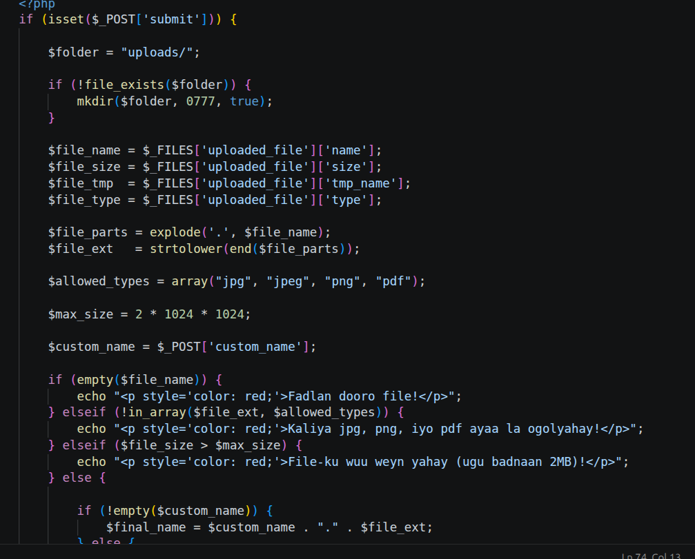
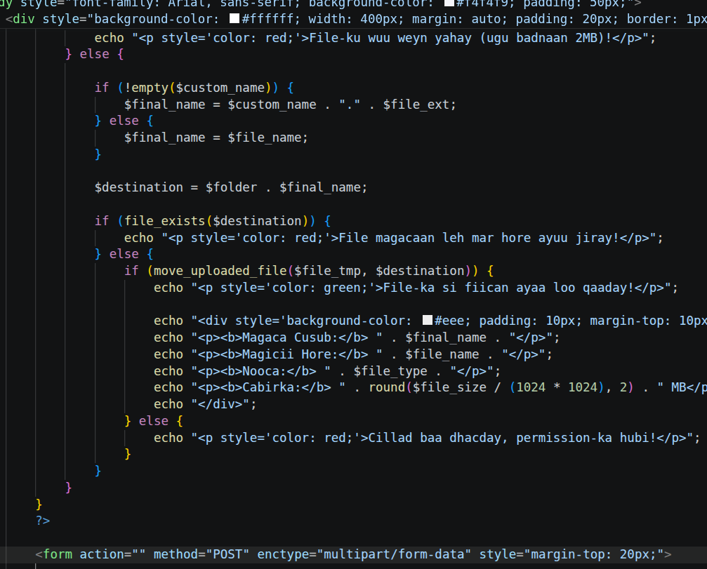

# Week 5

Mashruucan waa casharkii **Week 5** oo ku saabsan sida faylasha loogu upload-gareeyo PHP, loona sameeyo hubin (validation) iyo magac-beddel (rename).

---

## Qaybta 1-aad: Diyaarinta & Hubinta Faylka (Validation)

### Sharaxaadda Qaybta 1-aad:
1. **Diyaarinta Gal-ka (Folder):**
   * `$folder = "uploads/";`: Waxay qeexaysaa magaca galka faylku galayo.
   * `if (!file_exists($folder)) { mkdir($folder, 0777, true); }`: Haddii galku uusan jirin, PHP ayaa abuuraaya isagoo siinaya fasax buuxa (`0777`).

2. **Soo Saaridda Xogta Faylka:**
   * Waxaa la soo qabtay magaca (`name`), cabbirka (`size`), goobta kumeel-gaarka ah (`tmp_name`), iyo nooca (`type`).
   * `explode('.', $file_name)` & `end()`: Magaca faylka ayaa la kala jebiyay si loo helo extension-ka (sida `jpg`, `png`), waxaana lagu daray `strtolower()` si xuruufta loo wada yar-yeelo.

3. **Shuruudaha (Validations):**
   * `$allowed_types`: Array ay ku jiraan kaliya noocyada la oggol yahay (`jpg`, `jpeg`, `png`, `pdf`).
   * `$max_size = 2 * 1024 * 1024;`: Cabbirka ugu badan oo lagu xaddiday 2MB.
   * `if (empty($file_name))`: Waxay diidaysaa haddii aan wax fayl ah la soo dooran.
   * `elseif (!in_array($file_ext, $allowed_types))`: Waxay diidaysaa noocyada aan la oggolayn.
   * `elseif ($file_size > $max_size)`: Waxay diidaysaa faylka ka weyn 2MB.

---

## Qaybta 2-aad: Magac-beddelka & Dhaqaajinta Faylka (Move & Rename)

### Sharaxaadda Qaybta 2-aad:
1. **Magac-beddelka (Rename Logic):**
   * `if (!empty($custom_name))`: Haddii uu isticmaaluhu magac cusub soo qoray, waxaa la qaadanayaa magacaas cusub oo lagu daray dabadii (`$custom_name . "." . $file_ext`).
   * Haddii uu bannaanka kaga tagay, magaciisii hore ee asalka ahaa ayaa loo daynayaa.

2. **Dariiqa Rasmiga ah (Destination):**
   * `$destination = $folder . $final_name;`: Waxaa la isku dhejiyay galkii iyo magacii la doortay (tusaale: `uploads/sawir.jpg`).

3. **Hubinta Jiraanka Faylka (File Exists):**
   * `if (file_exists($destination))`: Waxaa la hubinayaa inaan fayl magacaan leh horey ugu jirin galka si uusan kii hore u tirtirin.

4. **Dhaqaajinta Faylka (Move Upload):**
   * `move_uploaded_file(...)`: Faylka waxaa laga soo qaadayaa kumeel-gaarka (`$file_tmp`), waxaana la geynayaa goobta rasmiga ah (`$destination`).

5. **Muujinta Natiijada (Output Details):**
   * Marka uu si guul leh u wareego, waxaa shaashadda lagu soo daabacayaa:
     * **Magaca Cusub**
     * **Magacii Hore**
     * **Nooca Faylka**
     * **Cabbirka oo loo beddelay MB** (`round($file_size / (1024 * 1024), 2)`)
   * Haddii uu fashilmana, waxaa soo baxaysa fariin khalad ah oo oranaysa `permission-ka hubi!`.